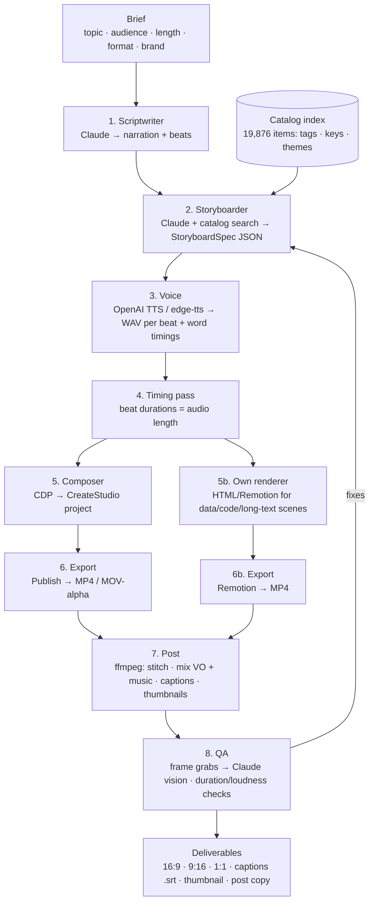

# CreateStudio AI Video Pipeline — Vision & Architecture

**Status:** Greenfield, discovery complete (2026-10-24)
**Workspace:** `D:\workspaces\createstudio`
**Goal:** Turn a text brief into a finished, branded animated video using the licensed CreateStudio Pro install and its asset library, with AI doing the writing, scene selection, composition, voice, captions and QA.

---

## 1. Summary

We can drive CreateStudio Pro programmatically. It has no official API, but it is an Electron app, and today we verified that it accepts Chrome DevTools Protocol (CDP) connections, runs with full Node integration in the renderer, and exposes its entire Vue 3 component API (project model, editor methods, 19,876-item asset catalog) to injected JavaScript.

This means we do not need to reverse-engineer the encrypted project format or extract assets. We let the real app do what it is licensed to do (compose and render), and we put an AI "director" in front of it that decides *what* to compose.

The recommended build is **Option 1 + Option 3**:

- **Option 1 — Drive the app.** A Node service launches CreateStudio with a debug port, connects over CDP, and composes projects by calling the app's own Vue methods and mutating its project model. Exports go through the app's bundled ffmpeg. Wrapped as an MCP server so Claude (or any agent) can call `create_video`.
- **Option 3 — Hybrid.** Scenes CreateStudio is great at (characters, templates, titles, transitions, VFX) come from CreateStudio. Scenes it is weak at (data charts, code, long text, dynamic lists) come from our own HTML/Remotion renderer. ffmpeg stitches, adds voiceover and burns captions.

---

## 2. What we have locally (verified)

### 2.1 The app

| Item | Value |
|---|---|
| Product | CreateStudio Pro 1.9.6 (Vidello Limited) |
| Install | `C:\Users\incre\AppData\Local\Programs\createstudiopro` (600 MB) |
| Runtime | Electron 13.1.3, Chromium 91, Node 14.16 (inside app) |
| UI | Vue 3.1.1 app, obfuscated bundle in `resources\app.asar` |
| Render | GSAP timeline + Fabric.js-style canvas → frames → bundled ffmpeg (x264, openh264, opus, mp3) |
| Export formats | MP4, WEBM, WEBM-alpha, MOV, MOV-alpha |
| Resolutions | 720p, 1080p, 4K, 1080², 2160², Stories 1080×1920, custom |
| User data | `C:\Users\incre\AppData\Roaming\CreateStudioPro` (1.2 GB) |
| Update | Pinned at 1.9.6. App offers 1.11.5; we decline ("Remind Me Later") until automation is mapped |

### 2.2 License

- Account is logged in. `expireAt = 2122-08-14` → **lifetime Pro license**.
- `monthlyExpireAt = 2025-01-12` → the **All Access Pass (AAP) subscription is lapsed**. Premium catalog items may show a crown / "Upgrade" prompt. The Templates page defaults to the *Free* filter.
- Catalog items do not carry a per-item `free` flag; access is resolved by the app per category/package (`purchasedItems`, `purchasedPackages`). **Open item:** measure in-app how much of each category is usable without AAP (see §9).
- The account also has credit counters for background removal, ElevenLabs TTS and "AI credits" — features of newer versions, not present in 1.9.6 UI.

### 2.3 Asset library

**Bundled on disk** (`resources\app.asar.unpacked\dist\static\commons`): 87 bundled fonts + Google Fonts index (3,751 previews), 70 hand PNGs, 245 shapes, 1,047 shape icons, 63 typewriter assets, 26 erasers, 22 effect thumbnails, 15 button presets, 10 carousel presets, device frames (monitor, phone), 14 basic templates.

**Cloud catalog loaded in-app (19,876 items)**, downloaded on demand to `Roaming\CreateStudioPro\resources` (44 downloaded so far, 1.2 GB):

| Type | Count | | Main category | Items | Sub-categories |
|---|---|---|---|---|---|
| preset (animations) | 8,538 | | Video Builder scenes (standard/vertical/square) | 7,325 | ~334 |
| image | 4,057 | | Icons | 3,476 | 15 |
| video | 2,377 | | Audio (music + 766 SFX) | 2,062 | 17 |
| audio | 2,062 | | Templates | 1,855 | 8 |
| template | 1,855 | | Backgrounds (752 are 3D) | 994 | 9 |
| svg | 651 | | VFX | 478 | 15 |
| sprite (characters) | 274 | | Doodle | 475 | 5 |
| reveal | 47 | | Boost Elements | 442 | 10 |
| model (3D characters) | 15 | | Stickers | 403 | 7 |
| | | | Characters (3D, Supreme, Bobble Heads, Flow, Doodle, Animals, Classy, scenes) | 337 | 10 |
| | | | Shapes | 334 | 5 |
| | | | Effects | 223 | 10 |
| | | | Scroll Stoppers | 213 | 2 |
| | | | Transitions | 202 | 11 |
| | | | Social Media | 184 | 3 |
| | | | Titles (Type Pro, Lower Thirds, Text Scenes) | 151 | 6 |
| | | | Hands | 106 | 4 |
| | | | Elements / YouTube / Reveal / CTA / 3D test | ~217 | |

Every catalog item carries `name`, `tags`, `keys` (keywords), `themes`, `duration`, `transparent`, `variants`. That metadata is what the AI will search over.

### 2.4 Machine & tooling

| | |
|---|---|
| Hardware | Ryzen 7 4800H (8c), GTX 1650 Ti 4 GB, 7 GB RAM, Windows 11 |
| Runtimes | Node 20.16, Bun 1.3, Python 3.9.2, Docker 29 |
| Media | ffmpeg 8.1 full build on PATH (plus the app's bundled 4.x) |
| AI SDKs | `anthropic` 0.100, `openai` 1.45, `google-generativeai` 0.3.2, `torch` 2.8 (Python) |
| Keys | `OPENAI_API_KEY` in env; Claude via Claude Code |
| Apps | Audacity, Obsidian, VS Code |
| MCP | Claude Code already runs MCP servers (snyvi, breathitation) → adding a `createstudio` server fits the existing workflow |

Not present (install only if needed): Ollama, local Whisper, edge-tts, Playwright.

---

## 3. The automation surface (verified today)

```mermaid
flowchart LR
  A[Our Node service] -- "CDP ws://127.0.0.1:9222" --> B[CreateStudioPro.exe<br/>--remote-debugging-port=9222]
  B --> C[Vue 3 app<br/>#app.__vue_app__]
  C --> D[globalProperties<br/>$settings · $helpers · $ipc · $router · $eventBus · $userSettings]
  C --> E[Component tree via<br/>#app._vnode.component]
  E --> F[Editor component<br/>data.project · data.media · 107 methods]
  E --> G[Root AppName<br/>data.resources (19,876) · data.user]
  B --> H[Node integration ON<br/>require('fs'), require('child_process'), electron.remote]
  F --> I[Publish → frames → bundled ffmpeg → MP4]
```

### 3.1 Entry points

| Layer | What we can do | Evidence |
|---|---|---|
| Launch | `CreateStudioPro.exe --remote-debugging-port=9222` | `/json` returned the page; screenshots and `Runtime.evaluate` work |
| Router | `/login`, `/dashboard`, `/video-builder`, `/project` | `$router.getRoutes()` |
| Dashboard (`welcome` component) | `showNewProjectPopup`, `clickBlankProject`, `selectProjectDialog`, `changeDashboardPage`, `loadFromBackup` | component methods |
| New-project modal | `clickCreateProject()`, `selectResolution`, `changeResolutionCat`, `onBackgroundChange` | **Called `clickCreateProject()` → landed in `/project` editor** |
| Templates page | `allItems`, `categories`, `useTemplate`, `downloadTemplate`, `setCategory`, `showFree/showAAP/showPurchased` | component state + methods |
| Editor (main) | `data.project` (settings, tracks[], camera, media, ui), `addScenesToProject`, `addScenesMusicToProject`, `addEffect`, `addTransition`, `groupElements`, `deleteCurrentElement`, `autoSave`, `loadProject`, `createNewProject` | 107 methods dumped to `editor-methods.json` |
| Scene Builder panel | `selectRatio`, `selectCategory`, `selectTag`, `selectTheme`, `downloadScene`, `addScene` | panel component |
| My Scenes panel | `addScene`, `getSnapshot`, `exportCat`, `moveToCategory` | panel component |
| Top bar | `saveProject`, `saveProjectAs`, `showRenderingQueue`, `setZoom`, `exitProject` | component methods |
| Preview/timeline | `init`, `createTimeline`, `moveIndicator`, `playVideo`, `updateFPS` | component methods |
| Global helpers | `$helpers.timeline.*` (snapToFrame, getProjectDuration…), `$helpers.media.copyToProject`, `$helpers.fonts.downloadGoogleFont`, `$helpers.takeProjectSnapshot`, `$helpers.changeResolution` | `$helpers` keys |
| Defaults | `$settings.default` = full default object for every element type (19 KB, saved as `settings-default.json`) | dumped |
| Export | Publish modal (mounted on click) → `publishingFormats` → ffmpeg | `$settings.publishingFormats`; `AppName.ffmpegPath()` |

### 3.2 Project data model (the "script" target)

```text
project
├─ settings {width, height, duration(frames@? 14400 default), title, background, autosave}
├─ tracks[]            ← 4 by default
│   └─ elements[]      ← objects below, each with timeline{start,duration}, animations[], effects[]
├─ camera[] / cameraEnabled
├─ media[]             ← imported files (copied into project folder)
└─ ui {...}            ← editor-only state
```

Element types with defaults available in `$settings.default`:
`text`, `textbox`, `typewriter`, `textCountdown`, `textRandomReveal`, `infiniteScroll`, `button`, `image`, `imageCanvas`, `video`, `audio`, `sprite` (character), `svg`, `svgShape`, `shape`, `rect`, `roundedRect`, `circle`, `arc`, `triangle`, `path`, `arrow`, `progressBar`, `chart`, `grid`, `carousel`, `deviceComponent`, `audioVisualizer`, `invertedShape`, `group`, `camera`.

Each element has position (`left/top/angle/scaleX/scaleY/opacity`), `timeline`, `animations` (34 animatable properties, easings list), `effects` (19 effect types), stroke/shadow params.

**Composition strategy:** build element objects from `$settings.default.<type>` + our values, push into `project.tracks[i].elements`, then trigger the editor's refresh (`ui.refreshTracks`) and autosave. Fall back to the app's own panel methods (`addScene`, `copyToProject`) where the model is complex (characters, scenes with downloads).

---

## 4. Target pipeline



### Stage notes

1. **Scriptwriter.** Claude turns the brief into a beat list: `{beat_id, narration, on_screen_text, intent (hook/explain/proof/cta), mood}`. Target length controls beat count.
2. **Storyboarder.** For each beat, Claude picks a *scene recipe* (character talking, title card, icon grid, B-roll + lower third, device mockup, CTA) and fills it with catalog items. Catalog search is a local index (SQLite FTS5 or embeddings) built from the app's `resources.all` metadata. Output is a `StoryboardSpec` (see §6).
3. **Voice.** OpenAI `tts-1`/`gpt-4o-mini-tts` (key already present) or free `edge-tts`. Word-level timings via Whisper (OpenAI API, or local `faster-whisper` later) feed captions and text-reveal sync.
4. **Timing pass.** Beat duration = VO duration + padding; animation in/out presets fitted to that window.
5. **Composer.** The CDP driver: open app → new project at the right resolution → for each beat add elements/scenes at the right track/time → set texts, colors, fonts (brand kit) → import VO/music into `project.media` → save.
6. **Export.** Trigger Publish, poll the rendering queue, wait for the MP4. Transparent MOV/WEBM lets CreateStudio characters be overlaid on our own renders.
7. **Post.** ffmpeg 8.1: concat, loudness-normalize, duck music under VO, burn or sidecar captions, generate thumbnail, produce 9:16 and 1:1 variants (CreateStudio can also render these natively via `changeResolution`).
8. **QA loop.** Grab frames at each beat boundary, have Claude check legibility, overlap, text overflow, brand compliance; auto-fix spec and re-render only the affected beats.

---

## 5. Where AI adds the most value

| Role | Model | Why it is high-leverage here |
|---|---|---|
| Scriptwriting & hooks | Claude | Turns one brief into N variants per platform in seconds |
| Scene selection | Claude + local search index | 19,876 tagged assets is too many to browse; retrieval + judgment picks on-brand items |
| Layout fitting | Claude (rules + a few-shot of good layouts) | Decides text size/wrap, safe areas per aspect ratio |
| Voiceover | OpenAI TTS (now), ElevenLabs (optional) | Consistent brand voice, instant re-takes |
| Captions | Whisper | Word timings for sync and accessibility |
| Visual QA | Claude vision on frame grabs | Catches overflow, clashing colors, unreadable text before you watch |
| Iteration | Claude via MCP | "Make the CTA shorter and punchier" → re-script one beat → re-render one segment |
| Batch content | Scheduler + MCP | A content calendar (CSV/Notion/Obsidian) drives dozens of videos unattended |

---

## 6. StoryboardSpec (our DSL)

A small YAML/JSON schema that is the contract between the AI stages and the Composer. Example:

```yaml
video:
  title: "Why SIPs beat lump sums"
  format: landscape          # landscape | square | vertical
  resolution: 1080p
  brand: dhansaathi          # → fonts, palette, logo, music mood
  duration_target_s: 45
beats:
  - id: hook
    narration: "Most people invest at the worst possible time."
    scene: character_talk
    character: { search: "office woman explaining supreme", pose: "explain" }
    background: { search: "gradient modern teal" }
    text: { headline: "Timing the market?", style: "title/type-pro-03" }
    anim: { in: "fade-up", out: "fade" }
  - id: proof
    narration: "A monthly SIP smooths the ride."
    scene: data_chart        # rendered by our own renderer (Option 3)
    chart: { type: line, data: sip_vs_lumpsum.csv }
  - id: cta
    narration: "Start with as little as five hundred rupees."
    scene: cta_card
    text: { headline: "Start your SIP today", sub: "dhansaathi.app" }
    music: { search: "corporate uplifting", duck_db: -14 }
```

Everything referenced by `search:` is resolved by the catalog index into a concrete asset id before composition.

---

## 7. MCP server design (`createstudio-mcp`)

Node/TypeScript, runs on this machine, owns the app process and a CDP connection. Tools:

| Tool | Purpose |
|---|---|
| `cs_status` | App running? logged in? version? queue state |
| `cs_search_assets(query, type?, category?, ratio?)` | Search the local catalog index |
| `cs_list_templates(category?)` | Template catalog with free/premium flag |
| `cs_new_project(format, resolution, title, background)` | Blank project via `clickCreateProject` |
| `cs_add_scene(beat, spec)` | Compose one beat (elements/scenes/text/media) |
| `cs_set_text(element_id, text, style?)` | Edit text in place |
| `cs_import_media(path)` | Add VO/music/images to project media |
| `cs_preview(beat_id)` | Screenshot the canvas at a time for QA |
| `cs_export(format, out_path)` | Publish and wait for the file |
| `cs_save(project_path)` | Persist `.cspro` |
| `cs_render_storyboard(spec)` | One-shot: spec → MP4 (chains the above) |

Internally: a `Driver` (CDP + helpers), a `Composer` (spec → project mutations), a `Catalog` (SQLite FTS over `resources.all`), a `Renderer` (Remotion/HTML for hybrid scenes), and `Post` (ffmpeg).

---

## 8. Phased roadmap

| Phase | Deliverable | Exit test |
|---|---|---|
| **M0 Spike (1–2 days)** | Script that opens app, creates 1080p project, adds a text element + background, imports an audio file, publishes MP4 | An MP4 appears on disk, plays, shows our text |
| **M1 Composer** | `StoryboardSpec` → project for 5 scene recipes (title, character talk, icon grid, B-roll + lower third, CTA) | 5 spec files render correctly |
| **M2 Catalog index** | SQLite FTS5 over the 19,876 items, free/premium flag resolved | `search("happy office woman")` returns usable sprites |
| **M3 AI stages** | Scriptwriter + Storyboarder prompts, Claude-driven, with brand kit | Brief → spec → video with no manual edits |
| **M4 Voice + captions** | OpenAI TTS, Whisper timings, ffmpeg post, 3 aspect ratios | One brief → 3 platform-ready files + .srt |
| **M5 MCP + QA loop** | `createstudio-mcp` registered in Claude Code; vision QA; re-render single beats | "Make beat 2 shorter" works from chat |
| **M6 Batch** | Content calendar → nightly batch, Obsidian/Notion notes as briefs | 10 videos unattended |

---

## 9. Risks, constraints, decisions

| Risk / constraint | Mitigation |
|---|---|
| Automation is mapped against v1.9.6 UI internals | Pin version; keep declining update; record component signatures in tests so breakage is detected, not silent |
| Code is obfuscated; some methods live in panels mounted lazily (Publish modal) | Map on demand via CDP; prefer model mutation over UI clicks |
| AAP lapsed → some premium assets locked | Build catalog index with free/premium flag; design recipes around free + already-purchased items; user can renew AAP if ROI is there |
| Licensing | Assets are used only inside the app and appear only in exported videos. We never extract or redistribute raw assets. Our own renderer uses our own/CC0 assets |
| 7 GB RAM, 4 GB GPU | Render one video at a time; 1080p; batch at night; close other apps during export |
| Python 3.9 is old | Keep Python for ffmpeg glue only; do the pipeline in Node/TypeScript (Node 20 / Bun) |
| Export takes real time (software encode) | Cache rendered beats; only re-render changed beats; stitch with ffmpeg |
| App needs login + online for resource downloads | Pre-download the asset set a brand uses; detect `connection.offline` |

**Decisions already taken (from you):** go with Option 1 + 3; keep declining the update; use the licensed asset library inside the app.

**Decisions still open for you:**
1. Which brand/product gets the first videos (DhanSaathi? OhMyDog? Taskflow?) — this sets fonts, palette, voice.
2. Voice provider: OpenAI TTS (key exists) vs ElevenLabs (better, paid).
3. Renew All Access Pass or design around free assets.
4. First target platform and length (YouTube Shorts 30–45s vs explainer 60–90s).

---

## 10. Appendix

### A. Verified CDP recipe

```powershell
Start-Process "C:\Users\incre\AppData\Local\Programs\createstudiopro\CreateStudioPro.exe" -ArgumentList "--remote-debugging-port=9222"
Invoke-WebRequest http://127.0.0.1:9222/json   # → page webSocketDebuggerUrl
```

```js
// inside Runtime.evaluate
const app  = document.querySelector('#app').__vue_app__;
const gp   = app.config.globalProperties;        // $settings, $helpers, $router, $ipc …
const root = document.querySelector('#app')._vnode.component;   // AppName: data.resources, data.user
// walk root.subTree → find component with data.project (editor), data.allItems (templates), data.step (new-project modal)
```

### B. Files produced during discovery (scratchpad)

`settings-default.json` (element defaults), `editor-methods.json` (107 editor methods), `editor-tree.txt` (components + methods), `catalog-summary.json`, `catalog-categories.json`, screenshots (`templates.png`, `editor.png`).
Location: `C:\Users\incre\AppData\Local\Temp\claude\D--workspaces-createstudio\5312873e-fada-4099-9b83-393811c2d273\scratchpad\`
These should be copied into `docs/discovery/` in M0.

### C. Key paths

| | |
|---|---|
| App exe | `C:\Users\incre\AppData\Local\Programs\createstudiopro\CreateStudioPro.exe` |
| Bundled ffmpeg | `...\resources\app.asar.unpacked\dist\static\applications\win\x64\ffmpeg\ffmpeg.exe` |
| Bundled static assets | `...\resources\app.asar.unpacked\dist\static\commons\` |
| User settings | `C:\Users\incre\AppData\Roaming\CreateStudioPro\settings.json` |
| Downloaded resources | `C:\Users\incre\AppData\Roaming\CreateStudioPro\resources\<id>\` |
| Projects | `C:\Users\incre\AppData\Roaming\CreateStudioPro\project\` (`.jcspro`, AES-256, leave encrypted) |
| Logs | `C:\Users\incre\AppData\Roaming\CreateStudioPro\logs\{main,renderer}.log` |
