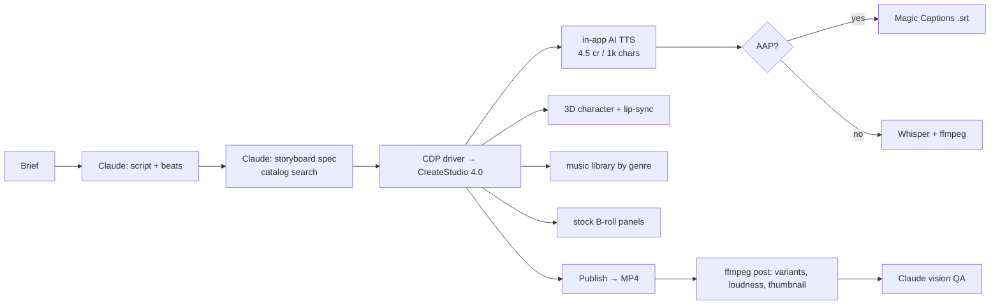

# What CreateStudio can actually do for the pipeline

**Status:** Audit complete (2026-10-25). Answers the question "why is CreateStudio only at one step of the pipeline, and can it do story, music or voice-over itself?"
**Sources:** installed build on this machine (bundle strings, component tree, update feed, logs) + CreateStudio support articles. Nothing here is taken from marketing alone.

---

## 1. Short answer

There are **two different products** on the table, and the vision doc only looked at one.

| | Installed now | Available to you for free |
|---|---|---|
| Name | **CreateStudio Pro 1.9.6** | **CreateStudio 4.0** (separate app, separate install) |
| Build date | 21 Jan 2023 | Feb 2025 launch, still updated |
| Last update on its feed | 1.11.5 (13 Nov 2023). The Pro line stopped there | n/a |
| Story / script | No | **Yes**: AI Explainer Builder, AI Shorts Builder, AI VSL Creator, AI Hook Generator |
| Voice-over | Mic recorder only | **Yes**: AI Text-to-Speech (4.5 credits / 1,000 chars, 1,000-char clips, `[PAUSE=s]` tags) plus the recorder |
| Lip-sync | No | Yes, for "3D Creator" customizable characters only (right-click audio, "Sync with <character>") |
| Captions | No | **Magic Captions** (speech-to-text, .srt export), **All Access Pass only** |
| Music | 2,062-track library (1,296 music + 766 SFX, 17 genres); Video Builder auto-adds a genre track | Same library; the AI builders pick music by genre |
| Stock media | Pexels, Pixabay, Unsplash, Giphy, Coverr, SVG API panels | Same |
| Background removal | API exists but gated to active monthly users | "Free AI Background Removal" plus Object Remover, Upscaler, Text Remover, Image Generator (3 credits/img) |
| AI credits on your account | Counters visible but no UI to spend them | **1,000 one-time credits** come with the lifetime licence; your account already shows the counters |
| Automation | Verified: CDP + Vue internals, Node integration on | Unknown until installed (very likely still Electron: same vendor, same login, opens 3.0 projects) |

So: the pipeline put CreateStudio at steps 5 and 6 only because **1.9.6 genuinely has nothing else**. No script, no TTS, no captions. CreateStudio 4.0 covers script, voice, scenes, music and captions in one app. Eligibility is confirmed by the vendor: earlier-version buyers get 4.0, but it is **not an auto-update**. You download it separately from `download.createstudiopro.com`, log in with the same account, and the Migration Tool moves saved scenes, fonts and presets.

---

## 2. Installed build, verified locally

| Item | Value |
|---|---|
| Path | `C:\Users\incre\AppData\Local\Programs\createstudiopro` |
| `package.json` | name `createstudiopro`, **version 1.9.6**, Electron main `dist/electron/main.js`, licence "commercial" |
| Exe | `CreateStudioPro.exe` 136 MB, dated 21 Jan 2023 |
| Bundle | `resources/app.asar` 131.6 MB, 13,414 files; renderer `dist/electron/index.js` 16.7 MB (obfuscated), `rendering-queue.js` 11.9 MB, `index-area-selection.js` 0.75 MB (screen-record region picker) |
| Unpacked helpers | ffmpeg 4.x + ffprobe (x64 and ia32), `recorder-helpers/RecorderHelpersWindows.exe` (.NET: cursor capture, window enumeration, mouse hooks) |
| Update feed | `https://autoupdate.createstudiopro.com/win/` → `latest.yml` says **1.11.5, released 2023-11-13, 585 MB**. Nothing newer on this feed |
| User data | `C:\Users\incre\AppData\Roaming\CreateStudioPro`: 43 downloaded resources, 1 Google font (Archivo), 2 basic templates, empty "My Scenes" |
| Deps of note | `fluent-ffmpeg`, `mac-screen-capture-permissions`, `cryptr` (project encryption), `paper` (vector), `fontkit`, `mathjs`, `axios`, jQuery / jQuery-UI |

### 2.1 Editor panels present in 1.9.6 (from the Vue component map)

`Media · Effects · MyScenes · VideoBuilder · Components · Elements · Record · Top · CameraTopBar · RightPanel · Publish · ContainersBreadcrumbs`

### 2.2 Feature by feature, with evidence

| Capability | In 1.9.6? | Evidence | Usable by us? |
|---|---|---|---|
| **Script / story generation** | No | 0 hits for storyboard, openai, chatgpt; "script" hits are all `description` / `javascript` | Claude does it (as planned) |
| **Text-to-speech** | No | 0 hits for text-to-speech, ElevenLabs; "tts" hits are all `https` | OpenAI TTS / edge-tts (as planned) |
| **Voice recorder (mic)** | Yes | `Record` panel, `Microphone` label, `MediaRecorder(stream,{audioBitsPerSecond:256000})`, `importRecording()` in the Media panel | Not useful for automation (needs a human talking) |
| **Screen recorder** | Yes | `loadScreenRecording()`, `isScreenRecording` flag with `mousePosition` / `mouseImage` sidecar files, `RecorderHelpersWindows.exe` draws the cursor | Useful for product-demo videos of your own apps (DhanSaathi, Taskflow) |
| **Webcam** | Yes | `Webcam` label in the Record panel | No |
| **Lip-sync / talking characters** | No | 0 hits for lipsync, mouth, talking, phoneme, viseme | Only in 3.0+ / 4.0 |
| **Captions / subtitles** | No | "subtitle" hits are ffprobe codec types and a MIME table; "caption" hits are CSS and font names | Whisper + ffmpeg (as planned), or Magic Captions in 4.0 with AAP |
| **Music library** | Yes | Audio 2,062 = Sound FX 766 + Logo Idents 230 + genres: Pop 125, Future Bass 119, Rock 99, Corporate 95, Cinematic 87, Dance 87, Hip Hop 70, Stomp 70, Happy 60, Funk 47, Ukulele 44, Vloggers 43, Christmas 40, Indie 40, Minimal 40 | **Yes**. Items carry name / tags / keys / themes; add as an `audio` element (`volume, fadeIn, fadeOut, playbackRate`) |
| **Auto music for a scene sequence** | Yes | `addScenesMusicToProject()`, `adjustSceneMusicDuration()`, `musicCategories[]` on the Video Builder | **Yes**, but the Video Builder is AAP-gated (below) |
| **Video Builder (pre-made story scenes)** | Yes, gated | `openVideoBuilder(){ $helpers.aapActive(userInfo) ? router.push('/video-builder') : <upgrade> }` | Route exists; the 7,325 scenes show a crown without AAP. Free or already-purchased scenes still pass the `purchasedResource` check |
| **Templates (1,855)** | Yes, partly gated | `showAAP(item) = !trial && item.free!=1 && !aapActive && !purchasedResource` | The Free-filter subset is usable; count still to be measured in-app (vision doc §9) |
| **Stock media** | Yes | integrations: `pexels, pixabay, giphy, coverr, unsplash, svg-api` | **Yes**. Free stock images, videos, GIFs and SVGs via the app's own keys; good for B-roll |
| **Background removal** | API wired, gated | `testBGRemovalAPI`, `bgRemovalRemainingCount`, `monthlyUserActive` check | No (needs an active monthly plan) |
| **Audio visualizer element** | Yes | `audioVisualizer` default (500×100) | Yes, for voice-only beats |
| **Google Fonts** | Yes | `loadGoogleFontsJson`, `downloadGoogleFont` | Yes, brand fonts |
| **Export** | Yes | MP4 / WEBM / WEBM-alpha / MOV / MOV-alpha via bundled ffmpeg | Yes |

**Premium guard:** opening a project or scene with premium resources shows "This project contains premium resources and cannot be opened with your current plan." The composer must only reference free or purchased items.

---

## 3. CreateStudio 4.0: what it adds (vendor documentation)

| Feature | How it works | Cost |
|---|---|---|
| **AI Explainer Video Builder** | Homepage → aspect ratio → language → Promotional / Educational → product name → prompt → generates an **editable script** → "Generate Project" → full project in the editor | 85 credits / project |
| **AI Shorts Builder** | Prompt → aspect ratio, language, theme → optional 3D avatar, narrator voice, caption style, background music → edit scene descriptions and narration, add scenes → "Create Video" | 60 credits / video |
| **AI VSL Creator** | 7 questions about the product → sales script | 50 credits |
| **AI Hook Generator** | Analyses the project, writes a title / hook | not stated |
| **AI Text-to-Speech** | AI bot icon → Create Voiceover → pick voice (preview is free) → Generate → Import → audio lands in the Project Folder, drag to timeline. Max 1,000 chars per clip; `[PAUSE=3.5]` supported. Google TTS was free in 3.0 | 4.5 credits / 1,000 chars |
| **Auto lip-sync** | 3D Creator characters only: audio track above or below the character, same group → right-click → "Sync with <name>"; combinable with other actions | free |
| **Magic Captions** | Speech-to-text on any audio or video track, edit words and timing, export .srt (no .srt import) | **All Access Pass only** |
| **AI image tools** | Background removal (free), object remover, upscaler, text remover, image generator (3 credits / image) | mixed |
| **Credits** | $67 lifetime / Pro Pack → **1,000 one-time**; AAP monthly or yearly → 1,500 per month; $497 Lifetime AAP → 10,000 one-time; purchased packs never expire. 3.0 TTS credits convert automatically | |

Rough budget for 1,000 credits: about 11 explainer generations, or 16 shorts, or about 220,000 characters of TTS (roughly 4 hours of narration). Enough for the whole M0 to M4 roadmap without buying anything.

**Unknowns until 4.0 is installed (one afternoon to check):**
1. Is it still Electron with the debug port and Node integration on? Very likely: same vendor, same account, opens 3.0 projects, still an electron-updater style download page.
2. Can the AI builders be invoked from code, or only through the UI? Even UI-only, they can be driven via CDP clicks and `Input.insertText`.
3. Does the 4.0 project model match the 1.9.6 `project.tracks[].elements[]` shape we mapped? 3.0 projects open in 4.0, so it is at least backward compatible.
4. Does the lifetime Pro licence also unlock the 3D Creator characters needed for lip-sync?

---

## 4. What this changes in the pipeline

Three viable layouts. Recommendation is **C**.

### A. Keep 1.9.6 (vision doc as written)
CreateStudio = compose + export only. Script, voice, captions and timing are all external. Already verified to be automatable. Cost: our own TTS and Whisper. Risk: none new. Weakness: no talking characters, Video Builder locked.

### B. Install 4.0 and let it do everything
Brief → AI Explainer or Shorts Builder → project → export. Fastest first video, but we lose control over scene choice and brand consistency, and we spend 60 to 85 credits per generation plus TTS. Fine for a demo, poor for a repeatable brand pipeline.

### C. Install 4.0 and use it as a **smarter composer** (recommended)
Keep Claude as scriptwriter and storyboarder (steps 1 and 2: free, brand-controlled). Then:
- **Voice:** CreateStudio AI TTS inside the app (one less external service; audio is already in the project folder; enables lip-sync). Keep OpenAI TTS as fallback when credits run out.
- **Characters:** 3D Creator character plus "Sync with" for talking-head beats.
- **Captions:** Magic Captions only if AAP is renewed; otherwise Whisper + ffmpeg as planned.
- **Music:** app library by genre (works today) via `addScenesMusicToProject`.
- **Stock B-roll:** Pexels / Pixabay / Coverr panels inside the app (works today).
- **Fallback:** if 4.0 turns out not to be drivable, 1.9.6 stays installed side by side and the vision doc path still holds.

Pipeline under C:

### Open decisions this resolves or sharpens
- **Voice provider (decision 2):** CreateStudio AI TTS is now a third option, already paid for via the 1,000 credits. Test voice quality for Indian English before committing.
- **AAP renewal (decision 3):** what AAP buys is now precise: Video Builder scenes, premium templates and assets, Magic Captions, 1,500 credits a month. Decide after measuring the free-template count and hearing the TTS voices.
- **Decisions 1 and 4 (brand, platform)** are unaffected and still yours.

---

## 5. Suggested next step (goes before M0 in the roadmap)

**M0a: install CreateStudio 4.0 beside 1.9.6 (half a day).**
1. Download from `download.createstudiopro.com`, install, log in with the same account. Do **not** run the Migration Tool yet (nothing worth migrating).
2. Launch with `--remote-debugging-port=9223` and repeat the discovery probe (`docs/discovery/cdp-scripts/cdp-probe.js`): Vue version, `$settings.default`, editor methods, panel list.
3. Generate one AI TTS clip in Hindi or Indian English and listen; generate one AI Shorts video; note credits consumed (expect about 65).
4. Record the findings in `docs/discovery-4.0/` and decide A vs C.

Only then run the original **M0 spike** (text + audio → MP4 over CDP) against whichever version wins.

---

## 6. Sources
- Installed files: `C:\Users\incre\AppData\Local\Programs\createstudiopro\` (package.json, app.asar header, extracted `dist/electron/*.js`), `C:\Users\incre\AppData\Roaming\CreateStudioPro\{settings.json,logs}`, `https://cspro-autoupdate.s3.amazonaws.com/win/latest.yml`
- CreateStudio support: [CreateStudio versions](https://support.createstudio.com/en/articles/11874704-createstudio-versions), [Do I get 4.0 automatically?](https://support.createstudio.com/en/articles/11661677-do-i-get-createstudio-4-0-automatically-if-i-purchased-an-earlier-version), [AI Credits](https://support.createstudio.com/en/articles/11728384-createstudio-ai-credits), [AI Text-to-Speech](https://support.createstudio.com/en/articles/11728846-ai-text-to-speech), [AI Explainer Video Builder](https://support.createstudio.com/en/articles/11729061-ai-explainer-video-builder), [AI Shorts Builder](https://support.createstudio.com/en/articles/11729176-ai-shorts-builder), [AI Tools index](https://support.createstudio.com/en/articles/12082835-ai-tools), [Auto Lip Sync](https://support.createstudio.com/en/articles/11848959-3d-creator-using-auto-lip-sync), [Magic Captions](https://support.createstudio.com/en/articles/11729860-magic-captions), [Where to download the latest version](https://support.createstudio.com/en/articles/12046864-where-to-download-the-latest-version)
- Launch press release: [Banzai launches CreateStudio 4.0](https://banzai.gcs-web.com/news-releases/news-release-details/banzai-launches-createstudio-40-major-ai-enhancements-video)
