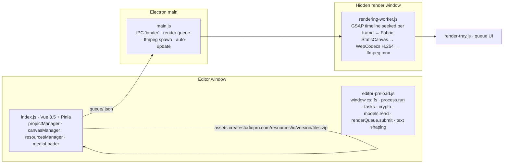

# How CreateStudio works locally, and what we can build ourselves

**Status:** research write-up, 2026-10-25. Based on reading the de-obfuscated 4.0.32 bundles, the files the app downloads, and live probing over CDP. One analysis (3D character code paths in detail) is still pending and will be appended as section 4b.
**Ground rule:** we take the mechanisms, formats and open-source building blocks; we build our own characters and assets. The vendor's models, scenes, templates and music stay inside their app and only appear in videos that app exports. Nothing here bypasses licence or credit checks, and no encryption keys were looked for.

---

## 1. Architecture at a glance



| Layer | Library | Version |
|---|---|---|
| 2D scene graph and drawing | Fabric.js `StaticCanvas`, heavily extended (custom classes per element type) | 4.2.0 |
| Timing and tweening | GSAP, paused timeline seeked manually | 3.5.1 (+CustomEase, RoughEase, SlowMo, ExpoScaleEase) |
| 3D characters | three.js + GLTFLoader + MeshoptDecoder (+Draco, KTX2) | r156 |
| Vector animation and emoji | lottie-web | bundled |
| Vector paths | paper.js | 0.12.18 |
| Text | own glyph layout: native `textShaping.node` (HarfBuzz-style API) with fontkit fallback, glyphs drawn as `Path2D` | |
| Transitions | gl-transitions registry (65 stock shaders, MIT) + 14 in-house | |
| Video decode | native ffmpeg demuxer binding + WebCodecs `VideoDecoder` | |
| Video encode | WebCodecs `VideoEncoder` (`avc1.640034`, hardware preferred) | |
| Mux and audio | ffmpeg 4.x (bundled), fluent-ffmpeg | |
| Background removal | ONNX Runtime, local model | |

Everything above is open source except the two small native bindings and the app's own code. Nothing in the render path calls the network.

## 2. The render pipeline, step by step (verified)

1. **Job**: the Publish panel writes `{format, destPath, project (JSON), width, height, quality, transparent, applyNormalization, addWatermark, useNewRenderEngine, mp4CustomBitrate, enableHardwareAcceleration}` to `queue/<uuid>.json` and calls `renderQueue.submit`. Main opens a hidden `BrowserWindow` (320x500, `backgroundThrottling:false`, WebGL on) running the worker bundle.
2. **Timeline**: `gsap.timeline({paused:true})`; every element gets `.call(showElement, start)` and `.call(hideElement, start+duration)`; animations are nested GSAP tweens per element. The loop is `timeline.seek(frame/30)` → `projectManager.updateAtTime(project, t)` (sets every element's properties, seeks videos, models, lotties) → `canvasManager.render()` → encode. Fixed 30 fps, no frame skipping; it busy-waits 3 ms until every async seek (video decode, model) has settled.
3. **Canvas**: `new fabric.StaticCanvas('rendering-canvas', {renderOnAddRemove:false, preserveObjectStacking:true, enableRetinaScaling:false})`, background colour or transparent. "High" MP4 quality renders at 2x and downsamples with a Lanczos filter. `objectCaching` is off everywhere; each object draws directly.
4. **Encode (new engine, MP4)**: `new VideoFrame(canvas, {timestamp: µs})` → `VideoEncoder` configured `{codec:'avc1.640034', hardwareAcceleration:'prefer-hardware', latencyMode:'realtime', framerate:30, bitrate, avc:{format:'annexb'}}`, key frame every 60 frames, back-pressure by polling `encodeQueueSize`. Chunks are appended to a raw `.h264` file; then `ffmpeg -r 30 -i video-stream.h264 -c:v copy -colorspace bt709 video-stream.mp4`. Bitrate table: 720p 5 Mbit, 1080p 8 Mbit, 1440p 16 Mbit, 4K 40 Mbit; x0.7 low, x1.5 high. The codec is probed with `isConfigSupported` plus a one-frame test encode, falling back to software and finally to the old engine.
5. **Old engine (WEBM, MOV, fallback)**: `canvas.toBlob` PNG (alpha) or JPEG 0.92 piped to ffmpeg stdin: `libopenh264` for MP4, `libvpx-vp9` with `yuva420p` for WEBM-alpha, `prores_ks -profile 4` for MOV-alpha.
6. **Audio**: no Web Audio. Each audio/video/typewriter element becomes one ffmpeg job `atrim, asetpts, volume, afade in/out, atempo → FLAC`, then one mix: `adelay` per clip, `amix=inputs=N:duration=longest:normalize=0`, optional `loudnorm=I=-23:TP=-2:LRA=7`, 48 kHz. Merge: `-c:v copy -b:a 256k -ar 48000`. Audio runs in parallel with video.
7. **Watermark**: `ctx.globalAlpha=0.5; drawImage(watermark)` on the 2D canvas before encoding (only when the job says so).
8. **Output**: written as `.part`, renamed on completion; progress over IPC to the tray; main keeps the last 10 jobs.

**Measured**: 4 s of 1080p30 rendered in 5 s wall-clock on this laptop (GTX 1650 Ti, hardware encode).

## 3. Asset formats on disk (verified by downloading free items)

All resources come from `https://assets.createstudiopro.com/resources/<id>/<version>/files.zip` (SVG: `file.svg`; templates: `<variant>/files.zip`), unzipped with adm-zip into `resources/<id>/`. Thumbnails and previews follow fixed names (`thumbnail.jpg|png`, `preview.mp4|webm|mp3`). The catalog is one zlib-compressed, encrypted file `info/resources.data` (fields `i,t,s,n,k,g,y,d,r,v,w,ss,f,p,a,b`) with a `resources-stamp.json` for cache busting.

| Type | Folder contents | What it really is |
|---|---|---|
| 2D character (`sprite`, also `reveal`) | `info.json` + `high.webm` (2160², 247 MB), `mid.webm`, `low.webm` | **One long VP9 video with alpha** (`alpha_mode=1`, 30 fps, 113 s) holding every action as a time range: `actions.<Name> = {start, end, loop{start,end}, crop{x,y,width,height}, default?}`. Robot has 29 actions, Jack 35 (Idle, Wave, Talking, Pointing, Thumbs Up, Walking, Sitting, "Talking & Listening"...). The editor builds a `spriteTimeline[]` of chosen actions and seeks the video. |
| 3D character (`model`) | `info.json` (165 KB) + `low.bin` (402 MB, encrypted, no glTF magic) | A GLB read through `cs.models.read` and parsed by GLTFLoader + Meshopt. `info.json` describes: `actions` (39 for Laura: Idle, Talking_To_The_Camera, Walking, Dancing, Pointing_*, Thumbs_Up, Sitting, Wave...) each with `actionStart/actionLoop/actionEnd = {name:'b_<action>_<phase>_root', duration, faceName:'f_<action>_<phase>_root'}` (separate body and face clips), `allowBlinking`, `allowExpressions`; `camera {fov 60, position, center, startAngles{theta,phi}}`; `colors` (Skin, Hair, Eyes... each an `objectList` of mesh names); `lipSync.morphTargets` (one morph target `<Name>_Mouth_Open` on every head-attached mesh); `blinking` (`<Name>_Blink`); `expressions` (Happy etc. as morph targets); `images` (texture slots: Logo, PC/Laptop/iPad screen, Sign, with aspect ratio and objectFit); `customizations` (Accessories, Bottom, Eyebrows, Glasses, Hairstyle, Hats, Shoes, Top: options with mesh lists and colour slots); `cropRect`. Mesh names are Maya exports (`...Shape_1`, `pasted__monitor2Shape`, `PIV` pivot suffix). |
| Scene preset (`preset`, 8,538 items) | `project.jcspro` (encrypted mini-project) + `media/<uuid>-{high,low,thumb}.svg|png|mp4` + `project-thumbnail.jpg` | A scene is just a small project: tracks, elements, animations and its own media. Importing clones elements with new ids, copies media into the project, and downloads "connected" resources (characters, videos) it references. Templates and "My Scenes" use the identical layout. |
| Audio | `file.flac` + `info.json` + `peaks.bin` (computed locally) | |
| Video | `info.json {hasAudio, format}` + `low/high.mp4|webm` | |
| Image | `info.json` + `low/high.png|jpg` | |
| Project | folder `<Name>.cspro/` with `project.jcspro` (JSON → encrypt), `media/`, `.bkp` autosave | We hold the JSON ourselves; no need to read theirs. |

## 4. Animation, effects, captions (from code)

- **Animation entry**: `{id, preset, type:'in'|'out'|'loop'|'custom', time, duration, settings{left,top,scale,angle,skew,opacity}, ease, easings{prop:ease}, to{}, splitTextType:'none'|'word'|'letter', splitTextDirection, splitTextOffset}`. Presets are `properties:[{name, keyframes:[{time, value, ease, adjustableBy}]}]`, loops replay a keyframe range N times. Catalogue: in/out × slide-left/right/top/bottom, scale-up/down, fade, rotate, skew-*, distort-x/y, each with `-back|-bounce|-elastic` variants (about 49 in, 37 out), 10 loops (slide, scale, blink, rotation-swing, skew), 41 combos. 34 animatable properties including shadow, stroke, corner radii and 4-corner distort. Easings are GSAP names.
- **Camera**: `project.camera[]` keyframes `{time, duration, ease, to{width,height,left,top,scaleX,scaleY,angle}}` on their own GSAP timeline.
- **Transitions**: (a) "reveal" = a sprite video played over the cut, (b) GL transitions between two elements (`glTransitionTarget/Type/Duration`), progress computed per frame.
- **Effects (19)**: overlay, green-screen (chroma key), sharpness, glitch, blur, hue, turbulence, jittering, wave, filters/LUT, color-correction, color-remove, color-replace, edge-feather, inner-shadow, twirl, clip-speed, reveal, doodle (hand-drawing with hand PNGs and erasers). Implemented as a WebGL2 fragment-shader pass chain per element.
- **Particles**: Canvas2D seeded particle element (shape SVG, count, speed, spiral/directional/swing/pulsate, gradient colours) plus 3 GPU "fx" presets (shining-dust, particles up/down).
- **Text**: own shaping and glyph paths; split-text staggers per word/letter; typewriter with per-key SFX mixed via ffmpeg.
- **Captions**: `captions.sentences[{text, startTime, endTime, emojiText, settings}]` from word-level speech-to-text results; 12 style presets (fill, stroke, highlight per word, position, animation, emoji). Hook title: a styled title/subtitle group with optional Lottie emoji.
- **Lip-sync (the whole algorithm)**: `ffmpeg -i voice.wav -ac 1 -af aresample=44100,speechnorm=e=25:r=0.0001:l=1 -f s16le -` → RMS per 1/60 s → 5-sample moving average → per frame `mouthOpen = rms[t] × lipsyncMultiplier (6)`, clamped to 1.4, written to the `Mouth_Open` morph-target influence. No phonemes or visemes; amplitude only. Blinking and expressions are other morph targets. This is why any audio file drives the mouth, credits or not.

## 5. What we can reuse legally

| Reusable | How |
|---|---|
| Every mechanism above | timeline model, preset schema, render loop, encoder pipeline, audio graph, lip-sync maths, caption schema |
| The libraries | Fabric.js, GSAP, three.js, lottie-web, paper.js, fontkit/HarfBuzz, gl-transitions, ffmpeg, WebCodecs, ONNX Runtime |
| Google Fonts | open licences |
| Videos exported by the licensed app | ours, including transparent overlays |
| The app as a renderer via CDP | documented in `docs/discovery-4.0/README.md` |

Not reusable: the vendor's character binaries, scenes, templates, music, icons, VFX clips; their server-side AI.

## 6. Our own pipeline: recommendation

**Keep the architecture, swap the assets.** CreateStudio's engine is a web page rendering a JSON scene with GSAP and Fabric, encoded by the browser. We can build the same thing with the same open-source libraries in a few thousand lines, and own every asset.

### 6.1 Scene format (one JSON, authored by Claude)
```jsonc
{ "settings": {"width":1920,"height":1080,"fps":30,"duration":15,"background":"#0b1220"},
  "assets": [{"id":"vo1","kind":"audio","src":"media/vo1.wav"}, {"id":"priya","kind":"character2d","src":"chars/priya/"}],
  "tracks": [{"elements": [
    {"id":"t1","type":"text","text":"Timing the market?","timeline":{"start":0,"duration":4},
     "transform":{"x":960,"y":300}, "style":{"font":"Libre Baskerville","size":96,"fill":"#fff"},
     "animations":[{"type":"in","preset":"slide-top","duration":0.8,"ease":"power3.out","split":{"by":"word","stagger":0.08}},
                   {"type":"out","preset":"fade","duration":0.4}]},
    {"id":"c1","type":"character2d","asset":"priya","action":"talk","lipsync":"vo1","timeline":{"start":0,"duration":6}},
    {"id":"a1","type":"audio","asset":"vo1","timeline":{"start":0.3}}
  ]}],
  "transitions":[{"from":"scene1","to":"scene2","name":"crosszoom","duration":0.6}] }
```
Presets as `properties[].keyframes[]` with `$param` substitution; a scene folder (`scene.json + media/`) zipped is the unit for presets, templates and "my scenes", exactly like theirs.

### 6.2 Characters (what to build first)
- **2D characters as alpha video**, the cheapest high-impact path and exactly what CreateStudio's 274 "characters" are. Make a character in Blender (Grease Pencil or rigged 2D), Rive, Spine, Adobe Animate or DragonBones, render each action (idle, talk, listen, point, wave, walk, thumbs-up, sit) to VP9 WebM with alpha at 1080² or 2160², and write the same `info.json` action map. Talking = a looping mouth cycle; optional amplitude-gated switching between a "talk" and "idle" loop gives cheap lip-sync.
- **3D characters later**, as plain GLB: Ready Player Me, VRoid (VRM) or Mixamo-rigged Blender characters; actions as glTF animation clips named `<action>_start/loop/end`; one `Mouth_Open` and one `Blink` morph target (ARKit `jawOpen`, `eyeBlinkLeft/Right` map directly); the amplitude lip-sync above, or Rhubarb Lip Sync for real visemes. three.js `AnimationMixer` plays start→loop→end exactly like the vendor's `b_*` clips.
- You pick the first character's look and action list; I generate the action spec and the render script.

### 6.3 Renderer
Node 20 + Playwright (headless Chromium) or Electron hidden window; Fabric.js 6 `StaticCanvas` + GSAP 3 paused timeline seeked per frame; WebCodecs `VideoEncoder` → raw H.264 → `ffmpeg -c:v copy` (or `mp4-muxer` to skip ffmpeg); audio graph with the same ffmpeg filter chain; gl-transitions for cuts; lottie-web for vector stickers; our own fonts via opentype.js/HarfBuzz. Expected speed: same order as CreateStudio (hardware encode, 1080p30 faster than real time).

### 6.4 Where CreateStudio still fits
Until our character library exists, CreateStudio 4.0 driven over CDP is the fastest way to get polished character scenes: render them as MOV/WEBM with alpha from the app and composite them in our pipeline. Both paths share the same scene JSON, so the AI stages (script, storyboard, voice, captions, QA) do not change.

### 6.5 Build order
1. Scene JSON + renderer skeleton (text, image, audio, animations, transitions) → MP4. Reuse the vision doc's M0 test.
2. Alpha-video character support + first custom character (your brief).
3. Captions from Whisper word timings with the 12-style caption model.
4. Voice from OpenAI/edge-tts; amplitude lip-sync.
5. Claude storyboarder writing this JSON; catalog of our own presets.
6. Optional: 3D GLB characters, GPU particles, per-element shader effects.

---

## Appendix: evidence locations
- Bundles: extracted and de-obfuscated copies in the session scratchpad (`asar4/`), script `dejoin.py`. Render worker report, asset-format report and the on-disk samples (`resources/jb4sel4zyc`, `pwac-pw8ek`, `72uirugdcm`, `ezvn9j65xt` under the CreateStudio4 data folder, now on `D:\apps\CreateStudio4-data` behind a junction).
- Live probes: `docs/discovery-4.0/` (`cdp-probe4.js`, `cdp-eval.js`, JSON dumps).
