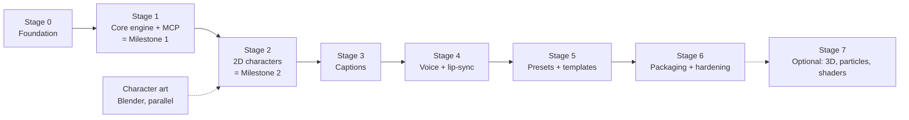

# Roadmap: Oratostudio

**Status:** draft for discussion, 2026-10-27. Oratostudio is the MCP-only video pipeline; this roadmap implements the decisions in `04-decisions-mcp-only-pipeline.md`. Requirements live in `06-product-requirements.md`, design in `07-technical-spec.md`.

This roadmap is ordered by stages, not dates. Each stage has a goal, what it delivers, and an exit gate. A stage is done when its gate passes, not when its work is "mostly there". Stages run in order unless marked parallel.

---

## Map

| Stage | Name | What exists at the end |
|---|---|---|
| 0 | Foundation | Repo, workspace packages, schema, project folder, test harness, render probe |
| 1 | Core engine + MCP server (**Milestone 1**) | A prompt in Claude Code produces an MP4 with text, images, audio, animations, transitions |
| 2 | 2D characters (**Milestone 2**) | A custom character acts in a video, driven by prompts |
| 3 | Captions | Word-timed captions in 12 styles from any audio |
| 4 | Voice + lip-sync | Script to voice to moving mouth, one prompt |
| 5 | Presets + templates | A catalog of our own animations, scene templates and styles |
| 6 | Packaging + hardening | Installable by someone who is not us; fallback ladder proven; docs |
| 7 | Optional | 3D GLB characters, GPU particles, shader effects |

---

## Stage 0: Foundation

**Goal:** the skeleton every later stage builds on, plus the one measurement that de-risks the whole plan (does headless Chrome get the GPU on this laptop).

**Deliverables**
- pnpm workspace with `packages/scene-schema`, `packages/renderer`, `packages/render-host`, `packages/mcp-server`, `packages/assets` (spec section 2).
- `scene-schema`: zod schema for `scene.json`, exported JSON Schema, fixtures for valid and invalid scenes.
- Project folder convention: `scene.json`, `media/`, `renders/`, `history/` (spec section 4).
- `render-host`: Playwright launch of full Chrome with the Windows flags from D6, and `render_probe` returning WebGL renderer string, WebCodecs hardware H.264 support, and measured frames per second on a blank canvas.
- Test harness: vitest for schema and tools; a golden-frame test runner (render a frame, compare to a stored PNG).
- One throwaway render page that draws a coloured rectangle and a timestamp, to prove the host loop (`seek`, capture, encode) end to end.

**Exit gate**
- `pnpm test` runs green on a fresh clone.
- `render_probe` output on the dev laptop is recorded in `04-decisions` (real GPU or SwiftShader, hardware encode yes or no, fps). Whatever the result, it is written down.
- The throwaway page renders 5 s to an MP4 that plays.

---

## Stage 1: Core engine + MCP server (Milestone 1)

**Goal:** the product exists in its smallest honest form. A user in Claude Code says what video they want, Claude calls tools, an MP4 appears, and edits by prompt work without pixel numbers.

**Deliverables**
- Renderer page (Fabric.js 6 + GSAP 3) with element types: `text`, `image`, `shape`, `video` (incl. alpha WebM), `audio`.
- Animation presets (in, out, loop) with the keyframe preset model from doc 03 section 4; split-text by word and letter.
- Transitions between scenes: cut, fade, and the gl-transitions set when WebGL is available.
- Layout engine: slot tables for 16:9, 9:16, 1:1; relative operations (nudge, align, size step, stack); text fit (shrink and wrap); image `cover` and `contain`.
- Layout linter (`layout_report`) and the guides overlay.
- Encode ladder rungs 1 to 3 (hardware WebCodecs, software WebCodecs, raw frames to ffmpeg).
- Audio graph via ffmpeg: trim, volume, fades, mix, optional loudness normalisation, mux.
- MCP server with the Milestone 1 tool set (spec section 6): project, element, media, preview, layout, render, history tools; the style and slots resources.
- Undo through numbered history snapshots.
- Teaching tool descriptions with examples; corrective error messages with nearest valid values.

**Exit gate** (from `04-decisions`, Milestone 1 acceptance)
- `render_probe` on the dev laptop reports a real GPU renderer and hardware H.264; a 10 s 1080p30 render finishes faster than real time. If a rung fails, the failure and measured time are recorded.
- Ten natural-language edits each resolve in one tool call with no pixel numbers; `layout_report` reports zero overlaps afterwards. The ten edits are listed in the PRD (section 7) and are run as a scripted test.
- Doc 01's M0 test video (1080p, text element, background, imported audio) renders end to end through the MCP server.
- Tool-contract tests pass: every tool rejects malformed input with a corrective message and accepts every example in its own description.

---

## Stage 2: 2D characters (Milestone 2)

**Goal:** a character of our own, authored in Blender, acts on screen and is controlled by prompts ("have Nikki wave, then talk").

**Runs in parallel with Stage 1:** the character brief (look, action list, render settings) and the Blender work start as soon as the brief is agreed. The engine side lands in this stage.

**Deliverables**
- `character2d` element: an alpha WebM plus `info.json` action map `{start, end, loop, crop}` per action, same shape as doc 03 section 3.
- Action sequencing: an element carries a list of actions with durations; the renderer builds the sprite timeline and seeks the video; loops repeat; transitions between actions cut on loop boundaries.
- Character slots (`character-left`, `character-right`) with bottom anchoring and mirror (flip) support.
- Blender export script and checklist: action names, frame ranges, VP9 alpha encode, `info.json` generation, low/mid/high sizes.
- First character delivered into `packages/assets/characters/<name>/` with at least: idle, talk, listen, point, wave, thumbs-up.
- Tools: `character_add` and `character_act` (or the equivalent `element_add` forms; see spec section 6).

**Exit gate**
- A 15 s video with the character idle, waving, talking and pointing renders with no visible seams at loop boundaries.
- "Put the character on the right and make her point at the title" resolves in one or two tool calls.
- The same video renders from a CreateStudio alpha export dropped into `media/`, proving the element is source-agnostic (D8).

---

## Stage 3: Captions

**Goal:** word-timed captions in the 12-style caption model from any audio track.

**Deliverables**
- STT integration (whisper.cpp or faster-whisper, local) producing word timings as JSON in `media/`.
- `captions` element: sentences with word timings; 12 style presets (fill, stroke, per-word highlight, position, animation, emoji); caption slot per aspect ratio.
- Tool: `captions_generate` (from an audio asset, optional style) and edits through `element_edit` (change style, fix a word, re-time).

**Exit gate**
- Captions on a 30 s voice track are on time within one frame across the track in a scripted check.
- Every one of the 12 styles renders in a contact sheet and passes the layout linter in all three aspect ratios.

---

## Stage 4: Voice + lip-sync

**Goal:** script to spoken voice to a character whose mouth moves, in one prompt.

**Deliverables**
- TTS behind one tool (`voice_generate`): edge-tts first; OpenAI and ElevenLabs as alternate providers with the same arguments.
- Voice assets land in `media/` with duration probed; timing vocabulary `match vo1` makes elements follow the voice length.
- Amplitude lip-sync (doc 03 section 4): RMS per 1/60 s, moving average, multiplier, clamp. For 2D characters this gates between `talk` and `idle` loops; the same curve drives a `Mouth_Open` morph target when 3D arrives.

**Exit gate**
- "Make a 20 s explainer about X with Nikki narrating" produces a video where the mouth moves only while speech is audible.
- Switching the TTS provider changes nothing else in the scene.

---

## Stage 5: Presets + templates

**Goal:** Claude has a catalog to pick from, so videos look designed, not assembled.

**Deliverables**
- Animation preset library beyond the base set: combos, `-back`, `-bounce`, `-elastic` variants, loops.
- Scene templates: a scene folder (`scene.json + media/`) zipped is the unit, exactly as doc 03 section 6.1. Starter set: title card, lower-third talking head, bullet list reveal, stat callout, quote, end card.
- Style presets: palette, type scale, caption style, transition default, bundled as a named style applied at project level.
- Resources: `presets://animations`, `templates://scenes`, `styles://list`; `template_apply` tool.

**Exit gate**
- A six-scene video assembled only from templates plus text replacement renders and passes the linter.
- The style resource is enough for Claude to produce a consistent-looking video on a fresh session with no example in the prompt.

---

## Stage 6: Packaging + hardening

**Goal:** someone who is not us can install it, and it degrades gracefully on a worse machine.

**Deliverables**
- Published package with one-line setup for Claude Code and Claude Desktop (stdio); optional HTTP transport.
- First-run doctor: finds Chrome, ffmpeg, GPU; prints the ladder rung in use.
- Fallback ladder proven on a machine without an NVIDIA GPU (a VM or a second laptop), results recorded.
- Render cache: unchanged scenes reuse rendered audio stems and frames where safe.
- User docs: README, tool reference generated from the schemas, a worked example.

**Exit gate**
- Fresh Windows machine without our dev setup: install, configure, render the M0 video, following only the README.
- Every error a user can hit from a prompt has a message that says what to do next.

---

## Stage 7: Optional extensions

Taken on only when a real video needs them.

- 3D GLB characters via three.js `AnimationMixer`, `Mouth_Open` and `Blink` morph targets, action clips named `<action>_start/loop/end`.
- GPU particle presets and per-element shader effects (the 19-effect list in doc 03 section 4 is the menu).
- Camera keyframes (pan and zoom over the scene).
- Read-only viewer (D1 allows this and nothing more).

---

## Parallel track: character art

Independent of engine stages after the brief is agreed.

1. Brief: look, personality, colour palette, action list, target sizes.
2. Blender model and rig; idle loop first, then talk, listen, point, wave, thumbs-up, walk, sit.
3. Render to VP9 alpha WebM; generate `info.json`.
4. Review on the Stage 1 alpha-video element (no character code needed to view it).

---

## How we work each stage

- Open the stage by writing its tool and schema changes into `07-technical-spec.md` first, then build.
- A stage's exit gate is a scripted test wherever possible, checked into the repo.
- Decisions that change during a stage are edited into `04-decisions` with a date, never left in chat.
- Measurements (render speed, probe output, caption timing) are written into the docs, not remembered.
