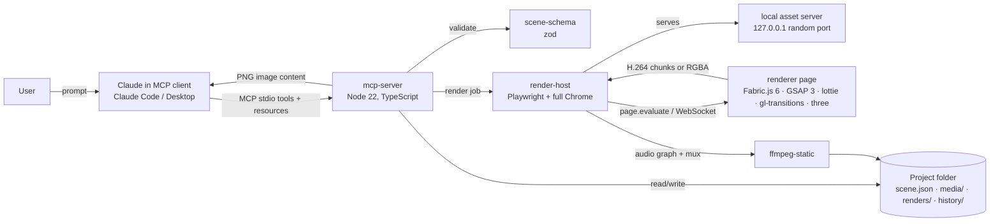

# Technical specification: Oratostudio

**Status:** draft for discussion, 2026-10-27. Binding decisions are in `04-decisions-mcp-only-pipeline.md`; requirements (FR-n) in `06-product-requirements.md`; stages in `05-roadmap.md`. Sections marked **proposed** are concrete proposals for the open points and need confirmation before the stage that uses them starts. This document is updated at the start of every stage.

---

## 1. System overview



Three processes at most: the MCP server (one Node process, spawned by the client), one Chrome instance it owns (kept warm between calls), and ffmpeg child processes per render.

Principles (from `04-decisions`):
- The server holds no model. It validates, patches, lays out, renders. Claude in the client is the author.
- Every mutation is a patch to `scene.json` followed by a history snapshot.
- Words are first-class values: sizes, slots, timings, presets, colour tokens.
- The renderer page is a pure function of (`scene.json`, assets, `t`).

## 2. Repository layout

```
oratostudio/
  docs/                         this folder
  packages/
    scene-schema/               zod schema, JSON Schema export, vocabulary, slot tables, resolvers
    renderer/                   browser bundle (Vite, single HTML): scene -> canvas at time t
    render-host/                Playwright launch, probe, asset server, encode ladder, ffmpeg audio graph
    mcp-server/                 tools, resources, project folder I/O, history
    assets/                     characters/, fonts/, presets/, templates/, styles/ with LICENSE files
  fixtures/                     sample projects and golden frames for tests
  scripts/                      Blender export, character packaging, dev-only CDP scripts moved from docs/discovery-4.0 when needed
  package.json  pnpm-workspace.yaml  tsconfig.base.json  vitest.workspace.ts
```

Published package names carry the scope: `@oratostudio/scene-schema`, `@oratostudio/renderer`, `@oratostudio/render-host`, `@oratostudio/mcp-server`. Package dependencies flow one way: `mcp-server -> render-host -> renderer` (bundle output only) and everyone `-> scene-schema`. `assets` is data.

Tooling: TypeScript 5 strict, Node 22, pnpm, vitest, tsup for Node packages, Vite for the renderer bundle, eslint + prettier, zod 3, `@modelcontextprotocol/sdk`, `playwright` (with `channel: 'chrome'`), `ffmpeg-static`, `mp4-muxer`, `webm-muxer`, `pixelmatch` + `pngjs` for golden tests, `ws` for the raw-frame channel.

## 3. Scene schema (`packages/scene-schema`)

One zod schema is the single source of truth. It is exported three ways: TypeScript types, JSON Schema (for the MCP tool input schemas and for documentation), and the vocabulary tables (for error messages and the style resource).

### 3.1 Top level

```ts
Scene = {
  version: 1,
  settings: {
    width: number, height: number,          // derived from aspect unless explicit
    aspect: '16:9' | '9:16' | '1:1' | 'custom',
    fps: 30,                                 // fixed per project
    background: Color,
    transparent: boolean,                    // alpha WebM output when true
    style?: StyleRef                         // Stage 5: palette, type scale, caption style, default transition
  },
  assets: Asset[],                           // everything under media/ or packages/assets that the scene references
  scenes: SceneSection[],                    // ordered sections; each has its own local timeline
  audio: AudioElement[],                     // project-wide audio (voice, music) on the global timeline
  captions?: CaptionsElement                 // Stage 3
}

Asset = { id, kind: 'image'|'video'|'audio'|'font'|'character2d'|'lottie', src, meta: { duration?, width?, height?, hasAlpha?, hasAudio?, actions? } }

SceneSection = {
  id, name?, duration: number | 'auto',      // 'auto' = last element end
  background?: Color,
  transitionIn?: Transition,                 // between previous scene and this one
  elements: Element[]                        // z-order = array order
}

Transition = { name: TransitionName, duration: number }
```

The global time of an element is `sceneStart + element.timeline.start`. Scene starts are the running sum of durations minus overlapping transition durations. Resolution of `'auto'`, relative timings and slots happens in a pure `resolveScene(scene): ResolvedScene` function used by both the server (for `layout_report`) and the renderer page, so both see the same numbers.

### 3.2 Elements

Common fields:

```ts
ElementBase = {
  id: string,                                // short, stable, human-readable: t1, logo, c1
  type: 'text'|'image'|'shape'|'video'|'audio'|'character2d'|'captions',
  timeline: { start: Timing, duration?: Timing | 'until end' },
  placement: Placement,
  opacity?: number,
  animations?: Animation[],
  effects?: Effect[]                         // Stage 7
}

Placement =
  | { slot: SlotName, align?: Align, fit?: 'cover'|'contain', nudge?: {x?: Pct, y?: Pct}, scale?: number }
  | { x: Px|Pct, y: Px|Pct, width?: Px|Pct, height?: Px|Pct, anchor?: Anchor, angle?: number }   // escape hatch

Timing = number | `after ${id}` | `after ${id} +${n}` | `with ${id}` | `with ${id} +${n}` | `match ${audioId}`
```

Per type:

| Type | Fields | Notes |
|---|---|---|
| `text` | `text`, `role: 'title'|'subtitle'|'body'|'caption'|'label'`, `size?: SizeWord|number`, `font?`, `weight?`, `color?: Color`, `alignText?`, `lineHeight?`, `maxLines?`, `background?: {color, padding, radius}` | role sets defaults from the type scale; size words step from the role's base |
| `image` | `asset`, `fit`, `radius?`, `shadow?` | |
| `shape` | `shape: 'rect'|'rounded'|'circle'|'line'`, `fill`, `stroke?`, `radius?` | M1 proposal: rect and rounded only |
| `video` | `asset`, `trim?: {start, end}`, `loop?`, `volume?`, `fit` | alpha WebM supported when `asset.meta.hasAlpha` |
| `audio` | `asset`, `trim?`, `volume?`, `fadeIn?`, `fadeOut?`, `speed?` | audio elements are never drawn |
| `character2d` | `asset`, `actions: [{name, duration?: number|'auto'}]`, `mirror?`, `lipsync?: audioId` | Stage 2; `auto` = one pass of the action, loops fill the remaining time |
| `captions` | `source: audioId`, `style: CaptionStyleName`, `sentences: [{text, start, end, words: [{w, s, e}], emoji?}]`, `slot?` | Stage 3 |

### 3.3 Animations

Same model as doc 03 section 4, simplified:

```ts
Animation = {
  type: 'in' | 'out' | 'loop',
  preset: PresetName,                        // see vocabulary
  duration?: number,                         // default per preset
  ease?: GsapEase,
  delay?: number,
  split?: { by: 'word' | 'letter', stagger: number }   // text only
}
Preset = { name, type, duration, properties: [{ name, keyframes: [{ time: 0..1, value, ease? }] }] }
```

Presets live in `packages/assets/presets/*.json` and are compiled to GSAP tweens on the page. `$param` substitution (`$distance`, `$angle`) lets one preset serve `slide-left`, `slide-right`, etc.

### 3.4 Vocabulary (proposed)

| Field | Words | Numeric form |
|---|---|---|
| size | `xs s m l xl xxl`; relative `larger smaller` (one step) | px |
| position | slot names (section 5) | px or `%` |
| timing | `after id`, `with id`, `+n` offsets, `until end`, `match audioId` | seconds |
| colour | `brand accent fg bg muted white black` plus named CSS colours | hex |
| in presets | `fade slide-left slide-right slide-top slide-bottom scale-up scale-down rotate blur` each optionally `-back -bounce -elastic` | |
| out presets | same names | |
| loop presets | `pulse float bob swing blink` | |
| transitions | `cut fade crossfade wipe-left wipe-right wipe-up wipe-down crosszoom` plus any gl-transitions name when WebGL is on | |
| ease | GSAP names: `power1..4.in/out/inOut back elastic bounce expo sine linear` | |
| caption style (S3) | 12 names, to be defined with the style set | |

Every enum has a `nearest(word)` helper (Levenshtein on the enum plus a synonym table: `bottom -> lower-third`, `top right -> corner-tr`, `huge -> xxl`) used by error messages: `slot "bottom" unknown; did you mean "lower-third"?`.

## 4. Project folder

```
<project>/
  scene.json                 current scene
  project.json               { name, createdAt, schemaVersion, lastRender }
  media/                     imported files, named <id>.<ext>; probe results cached in media/index.json
  renders/
    draft-0001.mp4           drafts and finals numbered
    final-0001.mp4
    frames/                  previews, overwritten; contact sheets
    stems/                   audio stems per element (cache, keyed by asset + trim + volume + fades)
  history/
    0001.json                full scene snapshot after each mutating tool
    log.jsonl                { n, tool, args, summary, at }
```

Rules: `scene.json` is written atomically (write `.tmp`, rename). Snapshots are full copies (a scene is kilobytes). `history_undo` moves a cursor and rewrites `scene.json`; a mutation after undo truncates the redo tail. Media is referenced by relative path only, so a project folder is portable and zippable (which is also the template format, Stage 5).

## 5. Layout engine (`packages/scene-schema/layout`)

### 5.1 Model

- Safe area: 5% inset on all sides. Title-safe: 10%. The linter flags anything outside the safe area; titles outside title-safe get a warning.
- A slot is a box in percent of frame plus a default anchor and alignment. Placement with a slot resolves to a pixel box at render time (FR-5).
- Text in a slot: lay out at role size; if it overflows, step size down to the role's minimum, then wrap to `maxLines`; if it still overflows, report `textOverflow` (FR-9). Never clip silently.
- Image and video in a slot: `cover` (fill, crop) or `contain` (fit, letterbox inside slot), default `contain` except `full-bleed` which defaults to `cover`.
- Stack: `stack: { with: [ids], gap: Pct }` on a parent placement lays children top to bottom inside the slot; used for title + subtitle, bullet lists.
- Relative ops are applied to placement by `element_edit` and persist as `nudge`, `scale`, `align` fields (not as pixel rewrites), so re-layout on aspect change keeps the intent.

### 5.2 Slot tables (proposed)

Values are `x y w h` in percent of frame; `anchor` is where the content sits inside the slot when smaller than it.

**16:9**

| Slot | x | y | w | h | anchor |
|---|---|---|---|---|---|
| title-top | 10 | 8 | 80 | 18 | top-center |
| title-center | 10 | 35 | 80 | 30 | center |
| lower-third | 6 | 72 | 60 | 16 | bottom-left |
| caption | 15 | 80 | 70 | 12 | bottom-center |
| corner-tl | 4 | 5 | 20 | 14 | top-left |
| corner-tr | 76 | 5 | 20 | 14 | top-right |
| corner-bl | 4 | 81 | 20 | 14 | bottom-left |
| corner-br | 76 | 81 | 20 | 14 | bottom-right |
| split-left | 6 | 12 | 42 | 76 | center |
| split-right | 52 | 12 | 42 | 76 | center |
| character-left | 4 | 15 | 36 | 85 | bottom-center |
| character-right | 60 | 15 | 36 | 85 | bottom-center |
| full-bleed | 0 | 0 | 100 | 100 | center |

**9:16** (bottom 18% and right 14% are treated as platform-UI zones for Reels and Shorts; caption and lower-third sit above them)

| Slot | x | y | w | h | anchor |
|---|---|---|---|---|---|
| title-top | 8 | 10 | 84 | 16 | top-center |
| title-center | 8 | 38 | 84 | 24 | center |
| lower-third | 8 | 60 | 76 | 10 | bottom-left |
| caption | 8 | 70 | 84 | 10 | bottom-center |
| corner-tl | 5 | 6 | 30 | 8 | top-left |
| corner-tr | 65 | 6 | 30 | 8 | top-right |
| corner-bl | 5 | 74 | 30 | 8 | bottom-left |
| corner-br | 56 | 74 | 30 | 8 | bottom-right |
| split-left | 4 | 28 | 45 | 44 | center |
| split-right | 51 | 28 | 45 | 44 | center |
| character-left | 2 | 35 | 50 | 65 | bottom-center |
| character-right | 48 | 35 | 50 | 65 | bottom-center |
| full-bleed | 0 | 0 | 100 | 100 | center |

**1:1**

| Slot | x | y | w | h | anchor |
|---|---|---|---|---|---|
| title-top | 8 | 8 | 84 | 16 | top-center |
| title-center | 8 | 36 | 84 | 28 | center |
| lower-third | 6 | 74 | 70 | 14 | bottom-left |
| caption | 10 | 82 | 80 | 10 | bottom-center |
| corner-tl | 4 | 5 | 24 | 12 | top-left |
| corner-tr | 72 | 5 | 24 | 12 | top-right |
| corner-bl | 4 | 83 | 24 | 12 | bottom-left |
| corner-br | 72 | 83 | 24 | 12 | bottom-right |
| split-left | 5 | 15 | 44 | 70 | center |
| split-right | 51 | 15 | 44 | 70 | center |
| character-left | 2 | 20 | 45 | 80 | bottom-center |
| character-right | 53 | 20 | 45 | 80 | bottom-center |
| full-bleed | 0 | 0 | 100 | 100 | center |

Slot tables are JSON in `packages/scene-schema/slots/<aspect>.json` and are exposed as the `slots://<aspect>` resource so Claude can read them.

### 5.3 Layout linter (`layout_report`)

Input: `t` (seconds) or `scene: id` (checks several sample times across the scene). Output:

```ts
{
  t, elements: [{ id, type, box: {x,y,w,h}, slot?, visible }],
  issues: [
    { kind: 'overlap', a, b, areaPct },
    { kind: 'textOverflow', id, lines, needed },
    { kind: 'outsideSafe', id, side },
    { kind: 'outsideTitleSafe', id, side },
    { kind: 'lowContrast', id, ratio }          // text over background colour only; M1 best-effort
  ],
  summary: 'ok' | '2 issues: t1 overlaps logo (12%), sub1 outside safe area (bottom)'
}
```

Overlaps between an element and its own stack siblings, or anything with `full-bleed`, are not issues. Runs server-side on the resolved scene with font metrics measured once per font via the renderer page (cached), so it does not need a render.

## 6. MCP server (`packages/mcp-server`)

Server name `oratostudio`. Transport: stdio (`@modelcontextprotocol/sdk`), one server per client session. The server keeps one open project at a time (`project_open` switches). Tool input schemas are generated from zod. Every tool returns `content: [{type:'text', text: JSON}]` plus, for previews, `{type:'image', data, mimeType:'image/png'}`.

### 6.1 Tools (proposed, 14 for Milestone 1)

| Tool | Input (summary) | Returns | Stage |
|---|---|---|---|
| `project_open` | `path`, optional `create: {name, aspect, width?, height?, fps?, background?, transparent?}` | project summary: settings, scene list, asset list, last render | M1 |
| `project_settings` | partial settings patch (`aspect`, `background`, `style`, ...) | new settings + layout report summary if aspect changed | M1 |
| `scene_add` | `name?`, `duration?`, `after?: sceneId`, `transitionIn?`, `background?` | scene id and order | M1 |
| `scene_edit` | `id`, partial patch; also `move: {after}` and `remove: true` | scene summary | M1 |
| `element_add` | `scene`, element (any type's fields with words or numbers) | element id, resolved box, layout issues if any | M1 |
| `element_edit` | `id`, partial patch, plus ops: `size: 'larger'|'smaller'|word|px`, `moveTo: slot`, `nudge: {x,y}`, `alignTo: {target: id|'frame', edge}`, `stack: {under: id, gap}`, `zOrder: 'front'|'back'|'above:id'` | element summary, resolved box, layout issues | M1 |
| `element_remove` | `id` | ok | M1 |
| `media_import` | `path` or `url`, `id?` | asset record with probed meta | M1 |
| `layout_report` | `t?` or `scene?` | section 5.3 | M1 |
| `render_frame` | `t`, `overlay?: boolean`, `width?` (default 960) | PNG image content + text summary | M1 |
| `render_contact_sheet` | `count?` (default 12), `scene?`, `overlay?` | one PNG, each tile stamped with time and scene id | M1 |
| `render_video` | `quality: 'draft'|'final'`, `range?: {from,to}`, `scene?` | `{path, duration, renderSeconds, rung, warnings}` | M1 |
| `render_probe` | none | `{gpu, webgl: 'hardware'|'software', hwEncode, rung, fps, chrome, ffmpeg}` | M1 |
| `history` | `action: 'list'|'undo'|'redo'`, `steps?` | list of `{n, summary}` or restored scene summary | M1 |
| `character_add` | `scene`, `asset`, `slot`, `actions`, `mirror?`, `lipsync?` | element summary | M2 |
| `voice_generate` | `text`, `voice`, `provider?`, `id?` | asset record with duration | S4 |
| `captions_generate` | `source: audioId`, `style`, `language?` | captions element summary | S3 |
| `template_apply` | `template`, `after?`, `replace: {textId: newText}` | scene id | S5 |

`element_add` for a character is just `type: 'character2d'`; `character_add` is sugar with a tighter description because models pick tools by name. Same reasoning for `voice_generate` versus `media_import`.

### 6.2 Resources

| URI | Content | Stage |
|---|---|---|
| `scene://current` | the current `scene.json` | M1 |
| `scene://resolved` | resolved pixels and global times (what the renderer sees) | M1 |
| `style://guide` | the vocabulary, slot names, presets, timing words, conventions, and a short worked example; generated from the schema so it never drifts | M1 |
| `slots://16:9`, `slots://9:16`, `slots://1:1` | slot tables | M1 |
| `presets://animations`, `presets://transitions` | names, defaults, one-line descriptions | M1 |
| `assets://characters`, `templates://scenes`, `styles://list` | catalogs | M2, S5 |

### 6.3 Tool description contract

Every tool description has: one sentence of purpose, the vocabulary it accepts, and two or three examples of the form `"User says: make the title bigger -> element_edit {id:'t1', size:'larger'}"`. Descriptions are generated from a `tools/*.md` source so examples stay next to the schema and are tested (section 10).

### 6.4 Errors

All tool errors are `isError: true` with text of the form `<field>: <problem>. <nearest valid values or fix>.` Examples: `placement.slot: "bottom" is not a slot. Did you mean "lower-third"? Slots: title-top, title-center, ...`. Internal failures (browser crash, ffmpeg non-zero exit) are reported with the rung and the last 20 lines of the child's stderr, never a stack trace.

## 7. Renderer page (`packages/renderer`)

A single HTML file produced by Vite (inlined JS, CSS and the preset JSON), loaded by the host from the asset server. No framework. Exposes `window.renderer`:

```ts
interface Renderer {
  load(scene: ResolvedScene, baseUrl: string): Promise<{ fonts: string[], assets: number }>   // preloads fonts, images, decodes first video frames
  seek(t: number): Promise<void>                // sets GSAP timeline time, updates every element, awaits video/character seeks, draws
  capture(kind: 'png'|'bitmap'|'rgba'): Promise<Uint8Array | ImageBitmap>
  overlay(opts: {thirds, safe, slots, ids}): void   // draws guides on a separate layer for previews
  measureText(spec): TextMetrics                // used by the layout linter (font metrics cache)
  probe(): Promise<ProbeResult>
  encode: {
    start(cfg: {codec, width, height, fps, bitrate, hardware: boolean, container: 'mp4'|'webm'}): Promise<'hardware'|'software'|'unsupported'>,
    frame(t: number): Promise<void>,            // seek + VideoFrame + VideoEncoder.encode with back-pressure on encodeQueueSize
    finish(): Promise<void>                     // flush; chunks were streamed to the host over WebSocket as they arrived
  }
}
```

Internals:
- `fabric.StaticCanvas` with `renderOnAddRemove: false`, `enableRetinaScaling: false`, `objectCaching: false`; one Fabric object per element, created at `load`.
- One `gsap.timeline({paused: true})`. Each element gets show and hide calls at its global start and end and nested tweens compiled from its animation presets. `seek(t)` is `timeline.seek(t, false)` followed by per-element `updateAtTime(t)` for videos (`currentTime` seek, await `seeked`), characters (sprite timeline lookup, video seek), captions (active words), then `canvas.renderAll()`.
- Text: Fabric `Textbox` with web fonts loaded through `FontFace` from the asset server; `measureText` uses the same Fabric object off-screen. Shaping upgrade (opentype.js or harfbuzzjs) only if a defect appears (PRD section 9).
- Transitions: at a cut between scenes the renderer draws the outgoing scene to an offscreen canvas and the incoming to another, then runs the gl-transition shader on a WebGL2 canvas with `progress = (t - cutStart) / duration`, and draws the result to the main canvas. `fade` and `cut` have a 2D fallback for software WebGL.
- Alpha video: `<video>` elements with VP9 alpha WebM draw through `drawImage` into Fabric `Image`; the browser handles alpha compositing.
- Character 2D (Stage 2): `info.json` action map into a sprite timeline `[{action, from, to, videoStart}]`; `seek` maps `t` to a video time inside the current action's loop range; crop applied via Fabric clip.
- Lip-sync (Stage 4): the host precomputes the amplitude curve with ffmpeg (doc 03 section 4) and passes it in the resolved scene; the page switches `talk` and `idle` loops by threshold, or sets `Mouth_Open` influence for 3D later.

Determinism: no `requestAnimationFrame`, no `Date.now()`, no random without a seed; all time comes from `seek(t)`.

## 8. Render host (`packages/render-host`)

### 8.1 Browser lifecycle

- `chromium.launch({ channel: 'chrome', headless: true, args: [...] })` with args: `--use-angle=d3d11`, `--ignore-gpu-blocklist`, `--enable-gpu-rasterization`, `--disable-background-timer-throttling`, `--disable-renderer-backgrounding`, `--disable-backgrounding-occluded-windows`, `--autoplay-policy=no-user-gesture-required`.
- If `probe()` reports SwiftShader: relaunch `headless: false` with `--window-position=-32000,-32000` and keep it minimised (the vendor's hidden window approach). Recorded in the probe result as `mode: 'headed-offscreen'`.
- One browser and one page kept warm per server process; `load` is called again only when the scene or assets change (hash of resolved scene plus media index).
- Asset server: a tiny `http` server on `127.0.0.1:0` serving the project folder and `packages/assets` with `Range` support (video seeking needs it) and correct MIME types. The renderer page is served from the same origin so no CORS issues.

### 8.2 Probe

`render_probe` runs: WebGL renderer string via `WEBGL_debug_renderer_info`; `VideoEncoder.isConfigSupported` for `avc1.640034` with `hardwareAcceleration: 'prefer-hardware'` plus a 10-frame test encode timed; a 60-frame draw-only loop of the throwaway scene timed; `ffmpeg -encoders` grep for `h264_nvenc`. Output is cached for the process lifetime and written to `renders/probe.json`.

### 8.3 Encode ladder (D6)

| Rung | Where the encode runs | Transport to disk | When |
|---|---|---|---|
| 1 | WebCodecs hardware in page | H.264 chunks over WebSocket to Node, `mp4-muxer` writes fragmented MP4 (or `webm-muxer` VP9 with alpha) | probe says hardware |
| 2 | WebCodecs software in page | same | rung 1 unsupported or test encode fails |
| 3 | ffmpeg in Node (`h264_nvenc`, else `libx264 -preset veryfast`) | raw RGBA frames from `capture('rgba')` over WebSocket, piped to ffmpeg stdin (`-f rawvideo -pix_fmt rgba`) | rungs 1 and 2 unavailable, or transparent output when VP9 encode in page is unsupported (then `libvpx-vp9 -pix_fmt yuva420p`) |

Frame loop on every rung: `for f in 0..N: await renderer.seek(f/fps); await encodeOrCapture(f)`. Back-pressure: the page waits while `encodeQueueSize > 4` (rung 1 and 2) or the WebSocket buffered amount exceeds 64 MB (rung 3). Key frame every 60 frames. Bitrates: 720p 5 Mbit, 1080p 8 Mbit, 4K 40 Mbit; draft uses 480p at 2 Mbit.

Draft quality: 480p (854x480 or 480x854 or 480x480), rung as probed, audio mixed but not normalised, `-preset ultrafast` when on rung 3.

### 8.4 Audio graph

Ported from doc 03 section 2.6:
1. Per audio element: `ffmpeg -i src -af atrim=start:end,asetpts=PTS-STARTPTS,volume=v,afade=t=in:d=..,afade=t=out:st=..:d=..,atempo=s -ar 48000 stems/<key>.flac`, cached by key.
2. Mix: inputs with `adelay=<startMs>|<startMs>`, `amix=inputs=N:duration=longest:normalize=0`, then `loudnorm=I=-23:TP=-2:LRA=7` on final only, `-ar 48000`.
3. Mux: `ffmpeg -i video -i mix.flac -c:v copy -c:a aac -b:a 256k -shortest out.mp4` (for WebM alpha: `-c:a libopus`).
Audio runs in parallel with the frame loop.

### 8.5 Previews

`render_frame`: `seek(t)`, optional overlay layer, `capture('png')` at preview width (default 960 wide, scaled by CSS transform so the layout is identical to full size). `render_contact_sheet`: N seeks and captures composited into a grid with `sharp` or on a second canvas in the page, each tile stamped with `t` and scene id. Both return PNG as MCP image content.

## 9. Stage-specific designs

### 9.1 Characters (Stage 2)

Folder `packages/assets/characters/<name>/`: `info.json`, `high.webm` (2160 square), `mid.webm` (1080), `low.webm` (540), `thumbnail.png`, `LICENSE`. `info.json`:

```json
{ "name": "priya", "fps": 30, "size": {"width": 2160, "height": 2160},
  "actions": {
    "idle":  {"start": 0.0,  "end": 4.0,  "loop": {"start": 0.0, "end": 4.0}, "default": true},
    "talk":  {"start": 4.0,  "end": 9.0,  "loop": {"start": 4.5, "end": 8.5}},
    "wave":  {"start": 9.0,  "end": 12.0, "loop": {"start": 10.0, "end": 11.5}},
    "point": {"start": 12.0, "end": 15.0, "loop": {"start": 13.0, "end": 14.5}, "crop": {"x": 0, "y": 0, "width": 2160, "height": 2160}}
  } }
```

Sequencing: for each `{name, duration}` the sprite timeline plays `start..loop.start` once, repeats `loop` to fill, then `loop.end..end` as the exit if the next action differs. Blender export script (`scripts/blender/export_character.py`) renders each action to PNG sequences and `scripts/pack-character.ts` encodes to VP9 alpha (`libvpx-vp9 -pix_fmt yuva420p -b:v 0 -crf 24`) and writes `info.json` from a `actions.yaml` the artist fills in.

### 9.2 Captions (Stage 3)

STT: `faster-whisper` through a small Python CLI (`scripts/stt.py`, word timestamps on), or `whisper.cpp` binary; chosen by availability, output normalised to `{words: [{w, s, e}]}` in `media/<audioId>.words.json`. Sentences are split on punctuation and pauses over 0.6 s, max 6 words per caption line in 9:16, 10 in 16:9. The 12 styles are preset JSON: fill, stroke, active-word highlight colour and scale, background pill, position slot, in/out animation, emoji mode.

### 9.3 Voice (Stage 4)

`voice_generate` provider interface: `synthesize({text, voice, rate?, format: 'wav'}) -> file`. Providers: `edge-tts` (via the `msedge-tts` npm package or the Python CLI), OpenAI `tts-1`, ElevenLabs. Voice names are provider-specific, listed by `assets://voices`. Lip-sync curve: `ffmpeg -i voice.wav -ac 1 -af aresample=44100,speechnorm=e=25:r=0.0001:l=1 -f s16le -` into Node, RMS per 1/60 s, 5-sample moving average, `mouth = min(rms * 6, 1.4)`; stored next to the audio as `<id>.mouth.json`.

### 9.4 Templates and styles (Stage 5)

A template is a project folder zipped with `template.json` `{name, description, slots: [textIds...], tags}`. `template_apply` unzips to a temp dir, re-ids elements, copies media into the project, inserts the scene. Styles are JSON `{palette: {brand, accent, fg, bg, muted}, type: {title, subtitle, body, caption, label: {font, size, weight, lineHeight}}, captionStyle, transition}`; colour tokens in elements resolve through the active style at render time.

## 10. Testing

| Level | What | How |
|---|---|---|
| Schema | valid and invalid scenes, vocabulary resolution, nearest-value messages | vitest, fixtures |
| Layout | slot resolution per aspect, text fit, stack, linter issues | vitest on `resolveScene` with a mocked font metrics table |
| Tool contracts | every example in every tool description runs and validates; every tool rejects a malformed call with a corrective message | vitest spinning the server in-process with the SDK's in-memory transport |
| Golden frames | `render_frame` at fixed times on fixture projects compared with `pixelmatch` (threshold for font antialiasing) | vitest, tagged `browser`, runs where Chrome exists |
| End to end | M0 video and the ten-edit script (PRD section 7) through the MCP server, result MP4 probed with ffprobe for duration, fps, stream count | vitest `e2e` tag; also run manually before closing a stage |
| Measurements | probe output, render seconds per 10 s of 1080p30, preview latency | written to `renders/probe.json` and copied into `04-decisions` at each stage close |

## 11. Performance targets

| Metric | Target | Where measured |
|---|---|---|
| 1080p30 final render | faster than real time on GTX 1650 Ti | Stage 0 gate, Stage 1 gate |
| `render_frame` warm | under 1 s | Stage 1 |
| `render_frame` cold (browser launch + load) | under 5 s | Stage 1 |
| Contact sheet, 12 frames | under 5 s warm | Stage 1 |
| Draft 20 s video | under 15 s | Stage 1 |
| Tool call round trip for an edit (validate + snapshot + linter) | under 200 ms | Stage 1 |

## 12. Security and licensing

- The server reads and writes only inside the open project folder, `packages/assets`, and its own temp dir. `media_import` copies files in; it never links out.
- The asset server binds to `127.0.0.1` on a random port with a per-session token in the URL.
- No network calls during render. TTS and STT providers are called only by their tools, with keys from environment variables, never stored in the project.
- `packages/assets` carries a `LICENSE` per subfolder. Nothing from the vendor's library is checked in; the CDP discovery scripts stay in `docs/discovery-4.0` as research and are not imported by any package.

## 13. Open items for confirmation

1. Tool names and count in 6.1 (14 for M1).
2. Slot values in 5.2.
3. Vocabulary in 3.4, especially the preset and transition names.
4. `shape` in Milestone 1 (rect and rounded only).
5. First character brief (name, look, action list, sizes) for 9.1.
6. Draft resolution 480p, preview width 960.
